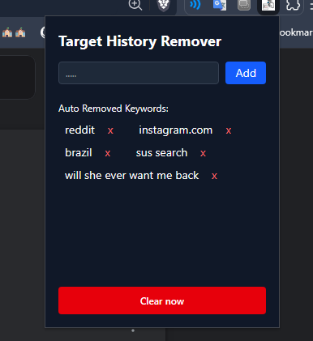

  

(drawn by me)

# Target History Remover

Chrome extension that automatically deletes any newly visited tabs/urls containing specified banned search terms.

## Pop-Up UI

## Features
- Auto-deletes from history visited pages containing banned terms.
- Manual button check all history and deletes ones containing banned terms..

## Installation
1. Clone this repo OR Go to release, download the zip, and unzip it.
2. Go to `brave://extensions` or `chrome://extensions`
3. Turn on **Developer mode** on the top right.
4. Click **Load unpacked** and select the folder containing this repo

## Limitations
- Does not clear cookies, cache, saved logins
- Google or Youtube account activity (obviously)
- Brave/Chrome sync on other devices.
- Addressbar autocomplete.
- Network level logs.

## Note
- All local

## Tech
- JavaScript
- Chrome Extensions API (Manifest V3)
- Tailwind CSS